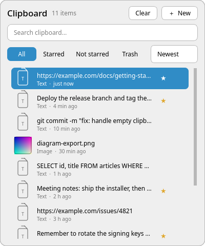
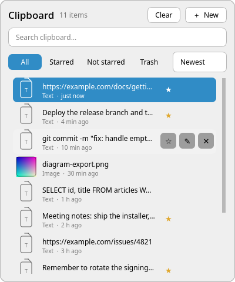
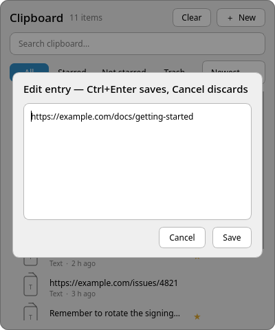
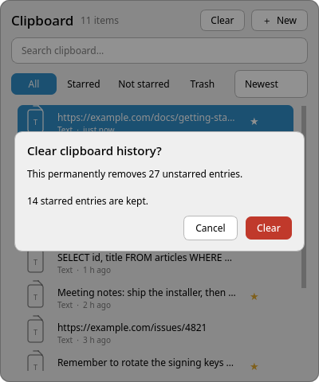

# custom-clipboard

A clipboard history popup for KDE Plasma with **click-to-paste**, laid out like
the Windows 11 clipboard panel and themed with Plasma/Breeze colours.

Press **Meta+V** (Win+V), click an item, and it is pasted straight into whatever
input you were typing in. No Ctrl+V afterwards.



---

## Install

```bash
cd <this folder>
./install.sh
```

No root needed. It builds, installs to `~/.local/bin`, registers autostart,
enables the `ydotool` helper and releases Klipper's Meta+V (including the
legacy `clipdeck` binding). A systemd autostart override restarts the app after
an unexpected exit, with a three-second delay.

**Log out and back in afterwards** so the shell picks up the key change.

To try it without installing:

```bash
./build.sh && ./custom-clipboard &
```

### Requirements

| Need | Why | Arch / CachyOS |
|---|---|---|
| Qt6 dev | build | `sudo pacman -S qt6-base` |
| KGlobalAccel | the Meta+V shortcut | `sudo pacman -S kglobalaccel` |
| g++ | build | `sudo pacman -S gcc` |
| **ydotool** | **injects Ctrl+V** | `sudo pacman -S ydotool` |

Debian/Ubuntu: `qt6-base-dev`, `libkf6globalaccel-dev`, `g++`, `ydotool`.

`build.sh` checks all four and names any that are missing.

**ydotool is the one that matters.** Without it the app still copies on click,
but you press Ctrl+V yourself. It writes to `/dev/uinput`, the kernel's
virtual-input device — the only reliable way to send a keystroke to another
application on Wayland.

Verify:

```bash
systemctl --user is-active ydotool.service   # expect: active
ydotool key 29:1 29:0                        # expect: silent, exit 0
```

---

## Using it

| Action | How |
|---|---|
| Open / close | **Meta+V** |
| Close by clicking elsewhere | click outside the panel |
| Paste an item | click it, or select + `Enter` |
| Search | type in the search box |
| Walk the list | **↑** / **↓** — works while the caret is in the search box |
| Switch tab | **All** / **Starred** / **Not starred** / **Trash** |
| Star an item | hover the row → **★** |
| Read or fix an entry | hover the row → **✎** — opens the full text, editable |
| Delete an item | hover the row → **✕**, or right-click → Move to trash |
| Restore from trash | on the **Trash** tab → **↩** (plain), **★** (restores it starred) |
| Copy without pasting | right-click → Copy only |
| Add an entry | **＋ New**, type, `Enter` |
| Clear unstarred entries | **Clear**, then confirm — they go to the **Trash** tab, not away for good |
| Empty the trash | **Trash** tab → **Clear Trash**, then confirm |
| Sort | dropdown: Newest / Oldest / A–Z / Z–A |
| Close without pasting | `Esc` |

The ★ and ✕/↩ buttons are click targets whether or not they are currently
drawn, so a fast click still hits them.



Notes:

- The **Starred**, **Not starred** and **Trash** tabs only appear when they have
  something to show, so they never clutter the UI. Starred entries are *not*
  pinned to the top of the All tab — they sort normally and live in their own
  tab.
- **Nothing is deleted outright.** ✕ moves the entry to the **Trash** tab, and
  **Clear** moves every unstarred entry there too. On the Trash tab the buttons
  mean exactly two things: **↩** brings the entry back as an ordinary one and
  **★** brings it back starred — so a trashed row never looks starred, whatever
  it was before. Clicking a trash row never pastes it.
- **Clear** on a history tab removes every unstarred entry and always keeps
  starred ones. **Clear Trash** is red and named differently precisely so the
  two can never be confused; it asks for confirmation with counts either way.
- Text and images are both handled. Copied **image files** (a `file://` path to a
  PNG/JPG/etc.) are detected and shown with a real thumbnail and filename.
- Timestamps are relative: "just now", "19 min ago", "1 h ago".
- The popup reopens where you left it: same tab, same search, and an open
  editor with its draft intact. Closing it mid-edit loses nothing.

### Read or edit an entry

Hover a row and click **✎** to see the whole text, with newlines intact. You can
fix a typo there and press **Save** (or Ctrl+Enter). Nothing else exits the
editor: **Esc** and clicks on the dimmed area leave the draft alone, and Meta+V
mid-edit keeps panel and editor exactly where they are. Only **Cancel** (or
Save) closes it. The edited text is written back into that entry only — the
clipboard is not touched. The button is there on trashed rows too: the
correction lands in the trash, so restoring afterwards brings back the fixed
text.



### Clear confirmation



---

## How it works

Klipper (Plasma's clipboard manager) keeps history in SQLite at
`~/.local/share/klipper/history3.sqlite`. This app reads that directly, so it is
**not** limited by Klipper's in-memory cap. Image payloads live as
content-addressed files under `~/.local/share/klipper/data/`.

Starring, clearing and restoring write to that same database, so Klipper sees
the changes and keeps its Starred tab in sync.

Deleting does **not** write to Klipper's database — it moves the row into a
sidecar at `~/.local/share/custom-clipboard/trash.json`, so restoring is a copy
back. Image payloads are left in Klipper's `data/` tree until the trash itself is
emptied, which is why restored images still show a thumbnail.

Clicking an item sets it through Klipper's own D-Bus API, closes the popup, waits
~200 ms for focus to return to your app, then injects Ctrl+V.

### Unlimited history

`MaxClipItems` in `~/.config/klipperrc` controls how much Klipper keeps. A Plasma
upgrade can reset it. Re-apply without logging out:

```bash
kwriteconfig6 --file klipperrc --group General --key MaxClipItems 1000000
qdbus6 org.kde.klipper /klipper org.kde.klipper.klipper.reloadConfig
```

`reloadConfig` applies it immediately.

### Why Klipper's Meta+V was released

Klipper ships Meta+V for its own popup and runs *inside plasmashell*, which
re-registers that key from memory. Changing it over D-Bus reports success and is
then silently overwritten — the only thing that works is editing
`~/.config/kglobalshortcutsrc`, and plasmashell re-reads that on next login.
`install.sh` writes the file and tells you when to re-login. `uninstall.sh`
restores it.

---

## Configuration

Optional, `~/.config/custom-clipboard.ini`:

```ini
[General]
autoPaste=true
pasteDelayMs=200
```

- `autoPaste=false` — click-to-paste copies only
- `pasteDelayMs` — raise if pasting is unreliable (focus has not returned yet).
  Try `300` or `400`.

---

## Troubleshooting

**Meta+V does nothing.** Klipper may still hold the key. Log out and back in — a
stale grab lives in `plasmashell`'s memory and only clears on restart.

**Clicking an item copies but does not paste.** Check
`systemctl --user is-active ydotool.service`. If it is active, raise
`pasteDelayMs`.

**"Copied, but ydotoold is not running".** The `ydotool` client is installed but
its background daemon is dead, so nothing can be typed for you. The app restarts
it for you when it finds it dead — the first click says it is starting the
daemon and asks you to click again — and it also checks at startup. Start it by
hand with `systemctl --user start ydotool.service` if you would rather not wait.
If it will not stay up, the journal will say `failed to open uinput device`,
which means your user cannot write to `/dev/uinput` — see the note in
`install.sh`.

**Pasting goes to the wrong window.** Wayland decides focus; add a little more
`pasteDelayMs`.

**Nothing happens when I click a row.** You may be clicking the action buttons
on the right of the row — ★ and ✕.

**Clicking ✕ twice pastes an entry instead.** Should be fixed; if you see it,
please report it. A double-click's second press arrives as a distinct event
type, and the button hit-test has to handle it.

**Clear says "Nothing to clear".** Every entry is starred, and Clear spares
starred entries by design. Unstar some first.

**"I deleted something by accident."** Open the **Trash** tab and click **↩**,
or right-click the row → Restore. Entries only disappear for good when you press
**Clear Trash**.

---

## Uninstall

```bash
./uninstall.sh
```

Restores Klipper's Meta+V and removes the binary, autostart entry and config.
`ydotool.service` is left in place (harmless, 44 KB); remove it with
`systemctl --user disable --now ydotool.service`.

---

## Further reading

- [DEVELOPMENT.md](DEVELOPMENT.md) — architecture, building, tests
- [AGENTS.md](AGENTS.md) — hard-won rules for AI agents editing this code